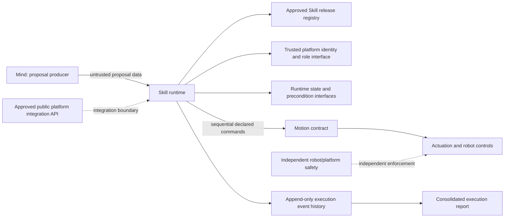

# Kritva Skill Architecture (Proposed)

**Task:** KOS-SKILL-001  
**Status:** PROPOSED — REPOSITORY-ADOPTED; NORMATIVE CONTRACT APPROVAL PENDING UPSTREAM REVIEW
**Version:** 0.1.0-draft  
**Prepared:** 2026-11-27

## 1. Purpose
Kritva Skill owns the contract that declares a Skill's identity, version, capabilities, inputs, outputs, preconditions, execution lifecycle, resource reporting and failure reporting. It resolves and orchestrates Mind proposals through declared capability interfaces. It does not implement underlying capabilities, own platform identity, replace robot safety controls or own the control plane.

## 2. Architectural principles
1. Mind proposes; Skill independently resolves, validates, authorizes and orchestrates.
2. A Mind proposal, priority, rationale, uncertainty or precondition claim never grants execution authority.
3. Execution is permitted only for an immutable release explicitly approved by a trusted registry.
4. Authorization uses RBAC with default-deny semantics and trusted identity/role assertions.
5. Preconditions are checked against trusted runtime state; unknown, stale or unverifiable state cannot permit execution.
6. Skill and Motion maintain separate state machines.
7. Initial Motion orchestration is sequential. Concurrent/coordinated execution requires a later approved Motion contract.
8. Execution provenance is preserved in append-only events and a consolidated report.
9. Emergency stop and robot safety enforcement remain independent of ordinary Skill authorization and cancellation.
10. Software conformance is not evidence of physical safety or hardware validation.

## 3. System context

The diagram is logical. It does not assert that any depicted service or integration is currently implemented or approved.

## 4. Responsibility boundaries

| Component | Owns | Does not own |
|---|---|---|
| Mind | Producing proposals and inference provenance | Authorization, Skill release approval, execution |
| Skill | Proposal disposition, release resolution, RBAC enforcement, Skill preconditions, orchestration, execution provenance | Identity issuance, emergency stop, capability implementation |
| Release registry | Approval state for exact immutable Skill release identities | Changing package contents or granting caller permissions |
| Platform identity boundary | Authenticated principal and trusted role assignments | Skill-specific execution disposition |
| Capability vocabulary governance | Versioned definitions and semantics | Per-invocation authorization |
| Motion | Command admission, execution and Motion-level behavior under its contract | Skill planning or Skill lifecycle |
| Independent safety layer | Robot/platform safety enforcement and emergency-stop function | Skill proposal resolution |
| Platform integration API | Approved public interface for platform integration | Private implementation dependencies |

## 5. Proposal processing flow
1. Receive a Mind result and preserve its provenance.
2. Validate the result envelope and supported Mind contract version.
3. Apply strict result-status eligibility: only COMPLETED results are eligible; PARTIAL, FAILED and CANCELLED results are not executable.
4. Evaluate each proposal independently.
5. Resolve Skill ID and version constraint only against approved immutable releases.
6. Verify manifest/package digests and capability definitions.
7. Obtain trusted principal and role assignments; enforce applicable RBAC permissions.
8. Validate parameters against the resolved manifest input schema.
9. Evaluate preconditions against sufficiently fresh trusted runtime state.
10. Record CLEARED or DECLINED disposition and reason.
11. Start a Skill run only for a CLEARED proposal.
12. Execute Motion operations sequentially under the initial orchestration model.
13. Record lifecycle and command outcomes as append-only events.
14. Produce a consolidated report, including partial effects and unresolved outcomes.

CLEARED means Skill eligibility checks passed. It does not mean Motion accepted a command or physical execution started.

## 6. State machines and vocabulary
### 6.1 Proposal disposition
RECEIVED -> CLEARED | DECLINED. Each proposal is evaluated independently. A declined proposal dispatches no Motion command.

### 6.2 Skill execution lifecycle
LOADED -> RUNNING -> COMPLETED | CANCELLED | FAILED, with an additional direct LOADED -> FAILED transition when the start-time authorization/release re-check fails. Such a pre-start failure dispatches no Motion command, carries a specific reason code and has termination_status=NOT_REQUESTED. LOADED means the execution context is prepared; it is not evidence that execution began. CANCELLED is terminal only after the required stop/safe-terminal outcome is confirmed. If that outcome is unresolved, Skill must not claim successful cancellation.

### 6.3 Motion lifecycle
Motion's lifecycle is defined by its separately approved contract. Skill must not equate its states with Motion's ACCEPTED, RUNNING or terminal states. Motion admission and execution confirmation remain authoritative for Motion command outcomes.

## 7. Authorization and trust boundaries
- Authenticated principal and role assignments originate from a trusted platform security boundary.
- Mind fields are untrusted input and cannot assert principal identity, roles or permissions.
- RBAC checks are default-deny and scoped to the relevant execution/robot context.
- Re-check principal roles/permissions and exact release eligibility immediately before LOADED -> RUNNING and before each subsequent Motion dispatch.
- If the start-time re-check fails or cannot be verified, transition LOADED -> FAILED with a reason code and termination_status=NOT_REQUESTED; do not dispatch Motion.
- Per-dispatch registry and identity checks make those services runtime availability dependencies; freshness and timeout policy remain open.
- Initial permission semantics include Skill invocation and cancellation; capability-level permissions may further restrict invocation.
- Emergency stop is not a Skill API operation and does not depend on skill.cancel.
- The exact Core/platform identity assertion and role-assignment interface are upstream blockers until their contracts are reviewed and pinned.

## 8. Release and capability governance
A release identity includes at minimum skill_id, SemVer version, manifest_digest, package_digest and immutable source_revision. Repository release establishes provenance; a trusted registry separately records PENDING, APPROVED, SUSPENDED or REVOKED. Only APPROVED releases are eligible for resolution.

Capabilities use a governed, versioned, extensible vocabulary. A manifest may declare only approved capability identifiers and versions. A capability declaration does not itself grant a caller permission.

## 9. Preconditions
Precondition validation is hybrid:
- A governed vocabulary defines common machine-evaluable semantics.
- Skill evaluates common and Skill-specific requirements against trusted runtime interfaces.
- Platform/robot safety independently enforces operational constraints.
- Motion performs its own admission and runtime checks.

A precondition result is SATISFIED, NOT_SATISFIED or UNKNOWN. Only SATISFIED permits progression. Stale, missing or unverifiable state produces UNKNOWN.

## 10. Motion orchestration
The initial model is sequential: dispatch one Motion command, await its terminal outcome, then dispatch the next. A rejection, failure, cancellation or unresolved outcome stops subsequent dispatch. Completed, failed, active/unresolved and undispatched steps are reported separately. No automatic rollback is assumed.

Concurrent, synchronized or coordinated multi-joint execution is deferred until Motion publishes an approved, versioned contract that explicitly supports the required semantics and Skill defines matching conformance behavior.

## 11. Cancellation
Cancellation requires an authenticated principal with applicable RBAC skill.cancel permission scoped to the execution/robot. The initiator receives no implicit cancellation authority. Skill stops issuing new commands and handles any active Motion command as the approved Motion/platform safety contract requires: request termination when specified, or allow it to reach a safe terminal state when that is the contractually safe behavior. Skill does not mandate abrupt termination. It evaluates acknowledgements/outcomes and records physical effects. Emergency stop remains independent. A safety-stop report records whether Skill or the platform/independent safety system initiated the stop.

A registry state of SUSPENDED or REVOKED, or revocation of a required principal role/permission, blocks new execution. During RUNNING, Skill stops new dispatch and handles an active command under the approved Motion/platform safety contract; the lifecycle becomes FAILED and termination_status reflects the verified outcome. Registry/identity outage also fails closed for new dispatch and uses the same safety-contract handling for an active command.

## 12. Execution evidence
Skill maintains an append-only execution-local event history and produces a consolidated final report. Events have stable IDs, execution ID, monotonic execution-local sequence number, timestamp, event type and relevant references. The report captures Mind provenance, immutable Skill release identity, authorization (including start-time and subsequent dispatch-time checks), release eligibility, revocation events, preconditions, lifecycle, Motion outcomes, partial execution, errors, resource usage and output/evidence references. Every terminal report includes termination_status and records whether a safety stop was initiated by Skill or observed from the platform/independent safety system.

Resource reporting distinguishes measured, estimated, declared-limit and unavailable values. Detailed resource measurement is deferred.

## 13. Upstream dependencies and blockers
See [DEPENDENCY_REGISTER.md](DEPENDENCY_REGISTER.md). No upstream contract is normative solely because a draft exists or a version is mentioned in a design note.

## 14. Explicit non-goals
- Implementing Mind, Motion, Core, Control Plane or capability behavior.
- Implementing an identity provider, enterprise role-management system or general-purpose policy engine.
- Claiming physical safety based on schema validation or software tests.
- Concurrent or coordinated multi-joint execution under the initial Motion contract.
- Automatic rollback or guaranteed reversibility of physical actions.
- Detailed resource metering.
- A production release registry service in KOS-SKILL-001.

## 15. Open contract-design work
Exact manifest schema; capability ID/version schema; registry query and approval record schema; trusted principal/role assertion contract; permission identifiers and scope grammar; precondition vocabulary and freshness semantics; error/reason-code registry; authorization/registry freshness, cache and timeout policy; safe in-flight command handling on revocation/outage; cancellation acknowledgement/timeout semantics; safety-stop interface and initiator evidence; Motion command correlation/idempotency encoding; event schema and persistence guarantees; final report schema; resource field definitions; supported Mind/Motion/Core contract compatibility ranges.
